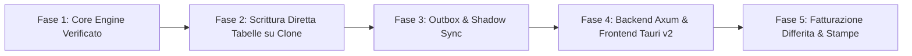

# ATLAS — Direttiva Architetturale e di Dominio Master
**Progetto:** ATLAS ERP (Interfaccia e Motore ad Alte Prestazioni per Arca Evolution)  
**Destinatario:** Sviluppatore / Coding Agent (Claude Code)  
**Versione:** 2.1 — Stato dell'Arte (SOTA) con Doppia Compatibilità  
**Data:** 22 Ottobre 2026  

---

## 1. REGOLA OPERATIVA SUPREMA: NESSUNA DECOMPILAZIONE, CODICE GIÀ ESTRATTO IN CHIARO

Tutti i sorgenti di Arca Evolution e delle personalizzazioni Tecnobit sono **GIÀ STATI COMPLETAMENTE ESTRATTI IN FILE DI TESTO IN CHIARO** nella cartella:
`docs/sorgenti_arca_decompilati/`

- `02_SORGENTI_FOXPRO_VFP/fedi_doc_extracted.prg` (51.373 righe di testo in chiaro che definiscono l'intera maschera documenti di Arca, i campi salvati, le query e le logiche contabili).
- `02_SORGENTI_FOXPRO_VFP/Cmd_DoPrelievoCreazione_extracted.prg`
- `02_SORGENTI_FOXPRO_VFP/ECR_Epson_RT_extracted.prg`
- `03_SORGENTI_CSHARP_NET/` (sorgenti C# per fatturazione elettronica e SdI)
- `pers_bottamedi/` (personalizzazioni pesate ortofrutta)

**Direttiva vincolante per Claude:**  
Non eseguire **MAI** strumenti decompilatori da riga di comando (`ilspycmd`, ecc.), non estrarre assembly da SQL Server e non analizzare binari protetti. Leggi e consulta **SOLO i file di testo già presenti** nella cartella `docs/sorgenti_arca_decompilati/`. Tutto ciò che serve per implementare il sistema si trova già lì dentro.

---

## 2. STRATEGIA DELLA DOPPIA COMPATIBILITÀ (SHADOW SYNC SENZA CHE ARCA SE NE ACCORGA)

L'obiettivo fondamentale del progetto è garantire la **doppia compatibilità assoluta**:
1. L'operatore al banco utilizza **ATLAS** (Desktop Tauri v2 + Rust) per battere le pesate e i DDT alla velocità della luce (<5 millisecondi, zero mouse, layout UserPref 1443).
2. ATLAS salva istantaneamente il documento nel suo database locale ad alte prestazioni.
3. Contestualmente, tramite un worker asincrono (**Transactional Outbox**), ATLAS replica il documento dentro il database SQL Server di Arca (`ADB_BOTTAMEDI_DEV` durante i test, e poi produzione).
4. **Arca Evolution deve continuare a vedere tutti i documenti normalmente**, come se fossero stati emessi direttamente da Arca, senza che gli operatori dell'amministrazione o il commercialista notino alcuna differenza.

```mermaid
flowchart TD
    UI["Tauri v2 Desktop (Operatore alla pesa)"] -->|Salvataggio DDT in <2ms| CORE["ATLAS Backend (Rust / Axum)"]
    CORE -->|Scrittura Primaria ACID| DB_LOCAL[("Database Primario ATLAS")]
    CORE -->|Registra Evento Outbox| OUTBOX[("Tabella Outbox")]
    
    subgraph Background Asincrono (Shadow Sync)
        WORKER["Shadow Sync Worker (Rust)"] -->|Preleva evento non sincronizzato| OUTBOX
        WORKER -->|Scrittura Diretta Tabelle| SQL_ARCA[("SQL Server Arca (DOTes, DORig, DOTotali, DOIva, MGMov)")]
    end
    
    subgraph Client Arca Esistente
        ARCA_CLIENT["Arca Evolution (Ufficio / Amministrazione)"] -->|Lettura Trasparente| SQL_ARCA
    end
```

### 2.1 Come scrivere su Arca senza blocchi (Scrittura Diretta Tabelle)
Poiché le stored procedure interne di Arca hanno controlli di sessione, la replica su SQL Server opera **scrivendo direttamente nelle tabelle relazionali**:
- `DOTes`: Testata documento (esercizio, tipodoc, sezionale, numero, data, cliente, pagamento).
- `DORig`: Righe merce (articolo, colli, lordo, tara, netto, prezzo, sconti, importo, iva).
- `DOTotali`: Totali calcolati (imponibile, imposta, totale documento, netto a pagare).
- `DOIva`: Castelletto IVA riepilogativo per aliquota.
- `MGMov`: Movimento di scarico magazzino collegato alla riga (`Id_DoRig`, `Cd_AR`, `Cd_MG`, quantità).
- `SC`: Scadenza/scadenziario di pagamento.

Tutti i valori di queste tabelle sono **già calcolati al centesimo dal motore `atlas-core`**, che ha già superato la verifica con il 100% di conformità su 60.496 documenti storici di Arca. I campi esatti da valorizzare sono documentati riga per riga in `fedi_doc_extracted.prg` (linee 36400-36600).

---

## 3. LOGICA DI VENDITA, PREZZI ED ERGONOMIA OPERATORE

### 3.1 Lookup Prezzi con Tasto F3: Maschera "PREZZO/COSTO ARTICOLO" (Esatta Replica Funzionale)
Premendo **`F3`** sul campo Prezzo si apre la schermata dedicata **"PREZZO/COSTO ARTICOLO"** (modulo `fastsrcform_arprezzo` di Arca), strutturata esattamente nelle 3 sezioni storiche aziendali:
1. **Dati da documento**: Mostra articolo corrente, rif. documento (es. `BO / C000059 del 21-10-2026`), valuta EUR, Prezzo Val. Listino, Prezzo Val Doc. Ivato, U.M., Fattore, Q.tà, Aliquota.
2. **Prezzi da listino**: Mostra tutti i listini aziendali (Listino 1, Listino 2...) con i rispettivi prezzi base e ivati.
3. **Ultimi prezzi da documenti**:
   - *Prz. ultimo doc. BOLLA VENDITA di [Cliente]*: Ultima vendita effettuata a questo specifico cliente.
   - *Prz. ultimo doc. BOLLA VENDITA (BO / [AltroCliente] del [Data])*: Ultima vendita effettuata a chiunque in assoluto (con indicazione di numero documento, cliente e data).
   - *Prz. ultimo doc. tipo Bolla di [Cliente]*.
   - *Prz. ultimo doc. tipo Bolla (BO / [AltroCliente] del [Data])*.
   - *Ultimo Acquisto*: Ultimo costo di acquisto da fornitore per riferimento margine.
- **Colonne esposte**: `Descrizione`, `Valuta`, `Prezzo Val. Listino`, `Prezzo Val Doc. Ivato`, `U.M.`, `Fattore`, `Q.tà`, `Aliquota`, `Sconto`, `Provvigione 1`, `Provvigione 2`, e colonna **`Riporta`** (checkbox attiva).
- **Selezione Rapida 100% Tastiera**: `Freccia Su` / `Freccia Giù` per scorrere tra le righe di listino o storico, e tasto **`Invio`** (o `Spazio` sulla colonna Riporta) per applicare istantaneamente il prezzo selezionato nella riga del DDT e tornare al flusso di battitura.

### 3.2 Protezione Prezzi in Anagrafica Articoli
- I prezzi e le schede anagrafiche sono protetti per evitare modifiche involontarie.
- Tasto rapido **`F2`**: Sblocca la modifica del prezzo in anagrafica articolo, si digita il nuovo valore e si conferma con **`F10`** (Salva immediato).

### 3.3 Sequenza di Battitura e Regola Sacra di Navigazione Griglia con Freccia Giù
L'interfaccia rispetta al 100% la cadenza quotidiana e la memoria muscolare dell'operatore:
$$\text{Codice Articolo} \xrightarrow{\text{Invio}} \text{UM} \xrightarrow{\text{Invio}} \text{Colli} \xrightarrow{\text{Invio}} \text{Lordo} \xrightarrow{\text{Invio}} \text{Tara} \xrightarrow{\text{Invio}} \text{Prezzo} \xrightarrow{\text{Invio}} \text{Nuova Riga}$$

#### Regola Fondamentale di Navigazione Verticale con `Freccia Giù`:
La pressione di **`Freccia Giù`** da qualsiasi cella della griglia righe esegue il seguente comportamento vincolante:
1. **Se la riga sottostante ESISTE GIÀ**: il cursore scende direttamente sulla cella sottostante mantenendo la stessa colonna (es. da Prezzo riga 1 a Prezzo riga 2, da Tara riga 1 a Tara riga 2).
2. **Se la riga sottostante NON ESISTE (era l'ultima riga del documento)**: viene creata all'istante la NUOVA RIGA successiva e il cursore si posiziona automaticamente sulla **PRIMA COLONNA (`Codice Articolo`)**, pronto per iniziare a digitare il nuovo prodotto.
- **Divieto di Intercettazione**: `Freccia Giù` non deve MAI aprire tendine o popup; è riservata esclusivamente alla navigazione verticale rapida tra le righe.
- **Formula del Netto**: $\text{Qta Netta} = \text{Lordo} - (\text{Colli} \times \text{Tara})$. Se $\text{Lordo} = 0$, allora $\text{Qta Netta} = \text{Colli}$.
- **Tasti Funzione Globali**:
  - **`F10`**: Salva Documento immediato.
  - **`F12`**: Salva Documento e Lancia Stampa immediata.
  - **`F3`**: Sul campo Numero Documento apre i buchi di numerazione; sul campo Prezzo apre il lookup prezzi; sul campo Articolo/Cliente apre la ricerca anagrafica.
  - **`Esc`**: Chiudi maschera o annulla operazione in corso.

### 3.4 Sincronizzazione Automatica Date
Le date del trasporto e della consegna nel piede (`DataConsegna`, `DataInizioTrasporto`) si allineano in automatico alla data documento `DataDoc` in testata. Zero popup bloccanti e zero interruzioni di battitura.

### 3.5 Guardrail Antierrore da Tastiera
1. **Tara Superiore o Uguale al Lordo (`Tara >= Lordo`)**:
   - Avviso visivo immediato da tastiera: `Esc` per correggere il campo Tara, `Invio` per confermare se intenzionale.
2. **Colli con Valori Decimali**:
   - Avviso immediato per evitare scivolamento di battitura con il peso lordo.
3. **Segnalazione Prezzo Modificato a Mano (Nessun Popup, Solo Sfondo Tenue)**:
   - Se l'operatore modifica il prezzo a mano rispetto al listino o allo storico, la cella assume un colore tenue (es. ambra chiaro) per dare visibilità immediata senza interrompere il flusso di lavoro.

### 3.6 Design System e UI SOTA Stile Apple / iOS
L'interfaccia deve unire la velocità brutale da tastiera di Arca con l'eleganza visiva e la pulizia grafica di iOS / macOS (Human Interface Guidelines):
- **Zero AI-slop e Zero Grigiume FoxPro**: Niente rilievi o finestrelle anni '90. Interfaccia pulita, contemporanea e minimale.
- **Tipografia di Precisione**: Font nitido stile San Francisco / Inter con gerarchie chiare. Tutte le colonne numeriche (colli, lordo, tara, netto, prezzi, importi, totali) usano cifre tabulari monospazio (`font-mono tabular-nums`) perfettamente allineate a destra.
- **Estetica Frosted Glass / Trasparenze Satinate**: Le finestre modali di ricerca rapida (`F3` clienti, `F3` prezzi) si aprono con sfondi satinati sfocati (`backdrop-blur-md`), bordi ultra-sottili da 1px e angoli dolcemente arrotondati (`rounded-xl`).
- **Focus Ring Apple**: La cella o il campo attivo hanno un focus ring luminoso e nitido (blu elettrico / accento Apple) che permette all'operatore di sapere all'istante dove si trova il cursore anche con la coda dell'occhio.
- **Palette Colori Raffinata**:
  - Dark Mode profondo in stile iOS (sfondi `slate-950` / `zinc-900`) ideale per non affaticare la vista all'alba o la notte in magazzino.
  - Light Mode nitido ad alto contrasto per gli uffici.
  - Badge a pillola per lo stato di sincronizzazione (verde smeraldo = sincronizzato in Arca, blu = in coda, rosso = errore riprova).

### 3.7 Firma d'Autore & Dettaglio Industriale "Off-White Style" (Bottamedi Gianluca)
L'applicazione possiede un'identità visiva esclusiva e sartoriale, firmata senza ostentazione (stealth luxury / industrial chic ispirato a Virgil Abloh / Off-White):
- **Autore e Architetto**: Bottamedi Gianluca.
- **Intestazione Aziendale Ufficiale (da DDT/Fatture)**:
  `BOTTAMEDI PIERLUIGI — Via Degasperi, 38017 Mezzolombardo (TN) — P.IVA 02273530226 — C.F. BTTPLG77S15F187I`
- **Micro-Tipografia Industriale Tone-on-Tone**: Nella barra di stato inferiore o a fondo pagina, integrata con opacità discreta (`opacity-35 text-[10px] font-mono tracking-widest text-zinc-500`):
  `"ATLAS" // ARCHITECTURE & DOMAIN LOGIC BY BOTTAMEDI GIANLUCA — KERNEL v2.1`
- **Coordinate Geografiche di Mezzolombardo & Batch Tag**: Accanto all'indicatore del server, una micro-etichetta tecnica industriale:
  `[ SPEC: BG-2026 / 46.2144° N, 11.0964° E — MEZZOLOMBARDO, TN — "DESIGNED FOR VELOCITY" ]`
- **Dettaglio di Classe nell'Area Riservata / About Modal**:
  All'apertura del pannello supervisore o delle info di sistema, compare il cartellino industriale con cornice sottile tecnica e virgolette iconiche:
  ```
  "ATLAS OPERATING SYSTEM"
  CONCEIVED & ARCHITECTED BY BOTTAMEDI GIANLUCA
  FOR "BOTTAMEDI PIERLUIGI" — MEZZOLOMBARDO (TN)
  P.IVA 02273530226 — ALL RIGHTS RESERVED © 2026
  ```
- **Effetto Visivo**: Sobrio, elegante, quasi invisibile a chi non lo sa cercare, ma immediatamente riconoscibile come un pezzo unico di design software su misura.

### 3.8 Personalizzazione Totale della Griglia (Resize, Riordino e Visibilità Colonne)
Sebbene il layout iniziale rispetti al pixel le proporzioni storiche di Arca (`UserPref 1443`) per garantire zero attrito al primo utilizzo, la griglia è **completamente personalizzabile dall'utente**:
- **Ridimensionamento a Trascinamento**: L'operatore può allargare o stringere qualsiasi colonna trascinando il divisore con il mouse o touch screen.
- **Riordino Colonne (Drag & Drop)**: Possibilità di spostare una colonna prima o dopo semplicemente trascinando l'intestazione.
- **Mostra / Nascondi Colonne**: Menu di configurazione per attivare o disattivare colonne a piacimento (es. nascondere colonne inutilizzate al banco come sconti secondari o provvigioni).
- **Salvataggio Automatico delle Preferenze (Persistenza Locale)**: Qualsiasi modifica alla larghezza, ordine o visibilità viene salvata istantaneamente nel profilo locale della postazione. Al riavvio dell'applicazione, la griglia si riapre esattamente con il layout personalizzato.
- **Tasto "Ripristina Layout di Fabbrica"**: Un pulsante rapido permette in qualsiasi momento di ripristinare le proporzioni e l'ordine predefiniti storici di Arca (`UserPref 1443`).

---

## 4. ARCHITETTURA DI GESTIONE BUCHI E AREA RISERVATA

### 4.1 Cancellazione Hard Delete e Riuso Numerazione Continua
- Quando un documento viene cancellato, viene rimosso dal database operativo (`DELETE FROM ...`).
- Nessun flag logico (`is_deleted`) e nessuna tabella di log nel database operativo: l'indice univoco su `(Esercizio, TipoDoc, Sezionale, NumeroDoc)` resta pulito e la numerazione non subisce blocchi.
- Il numero cancellato torna immediatamente disponibile come buco progressivo e può essere assegnato al documento successivo premendo `F3` sul campo Numero.

### 4.2 Archivio di Sicurezza Disaccoppiato
- Per prevenire perdite accidentali, all'eliminazione viene salvato uno snapshot di sicurezza in un archivio locale protetto, esterno al database operativo.
- Accessibile esclusivamente dall'area riservata del titolare tramite PIN supervisore.

### 4.3 Segregazione Privacy
- **Postazione Banco Magazzino (Personale)**: Interfaccia puramente operativa (DDT, Fatture, consultazione articoli). Nessun dato di fatturato globale o margine aziendale visibile.
- **Area Riservata Titolare (Accesso con PIN Supervisore)**: Dashboard direzionale, analisi margini, gestione emergenze.

### 4.4 Risoluzione Definitiva Incubo Fine Mese (Fatture Differite FT & Note di Credito NC)
In Arca la correzione di un DDT dopo l'emissione delle fatture differite è un processo farraginoso (cancellare la FT, sbloccare i DDT, modificare il DDT, rieseguire la creazione guidata, gestire i buchi). In ATLAS questo flusso diventa fluido e a 1-click:

#### 1. Correzione Pre-SdI (Fattura Differita ancora Bozza / Non Inviata a SdI):
- **Modifica Diretta del DDT con Propagazione Automatica**: Se un DDT è già incluso in una FT di fine mese ma la FT non è ancora stata trasmessa allo SdI, l'operatore può aprire e correggere il DDT (prezzo, tara, quantità). ATLAS rileva la fattura collegata e chiede: `DDT collegato a FT [Numero]. Vuoi aggiornare la fattura? [Invio = Sì]`. In 2 ms la FT viene ricalcolata e aggiornata in modo atomico, preservando il numero di fattura e senza dover cancellare nulla.
- **"1-Click Sblocca e Ri-emetti"**: In alternativa, dalla schermata della fattura differita, un singolo comando sblocca istantaneamente tutti i DDT collegati rimettendoli nello stato "Da fatturare", permette le correzioni e rigenera la FT con un tasto rapido.

#### 2. Correzione Post-SdI (Note di Credito NC Automatiche a 1-Click):
- Se la fattura è già stata trasmessa all'Agenzia delle Entrate, per legge fiscale non può essere modificata ma va stornata con Nota di Credito.
- **Generazione Automatica NC**: Dalla fattura trasmessa, il comando `Genera Nota di Credito` (parziale o totale) clona le righe da stornare, inserisce la causale corretta, il riferimento ministeriale `Rif. Nostra Fattura n. [X] del [Data]`, assegna il registro condiviso `001` e calcola lo scadenziario con segno a debito del fornitore/credito del cliente per compensare la partita contabile aperta (regola già certificata in `atlas-core`).

---

## 5. CONNETTIVITÀ SOTA SENZA VPN (mTLS 1.3) E UNIFICAZIONE CRM NATIVO IN RUST

### 5.1 Connettività Distribuita Sicura (Mutual TLS 1.3 - mTLS)
Per collegare postazioni multiple (pesa banco, ufficio, muletti, filiali remote o accessi esterni) senza dipendere da un'applicazione VPN attiva (come Tailscale o OpenVPN) che rischia di cadere o essere chiusa per sbaglio:
- **Architettura Zero Trust con mTLS 1.3**: La comunicazione tra le applicazioni client (Tauri v2) e il backend Axum avviene tramite HTTPS/TLS 1.3 con **autenticazione mutua a certificati (mTLS)**.
- **Certificato Client Integrato**: Ogni postazione autorizzata possiede un certificato crittografico embedded compilato o configurato nell'app. Se un nodo esterno tenta di connettersi via internet all'endpoint, la connessione viene respinta a livello di handshake TLS prim'ancora di scambiare dati applicativi.
- **Connessione Diretta e Veloce**: L'operatore apre ATLAS e il client si collega in meno di 1 millisecondo alla massima velocità di banda, senza bisogno di lanciare o mantenere demoni VPN sul sistema operativo.

### 5.2 Resilienza Offline-First (Protezione da Caduta Rete / Wi-Fi)
- Nel lavoro frenetico dell'ortofrutta all'alba, un'interruzione della connessione internet o un blocco del router Wi-Fi non deve mai fermare le pesate:
  - L'app desktop al banco implementa una cache locale SQLite in memoria: se la connessione al server centrale cade temporaneamente, **l'operatore continua a pesare e stampare i DDT senza interruzioni**.
  - Non appena la linea torna disponibile, le bolle accodate localmente vengono inviate e sincronizzate atomicamente sul database centrale tramite il pattern Outbox.

### 5.3 Unificazione Totale: CRM WhatsApp Nativo in Rust (`atlas-crm` / `atlas-hermes`)
Attualmente il CRM WhatsApp aziendale (HERMES) è implementato come servizio separato in FastAPI (Python) + React. La visione strategica definitiva è l'**unificazione totale**:
- In una seconda fase, il core del CRM WhatsApp verrà riscritto direttamente in **Rust puro** come modulo/crate integrato nel workspace (`crates/atlas-crm`).
- **Zero Bridge e Zero Latenza**: Il modulo WhatsApp accede direttamente in memoria alle tabelle di ATLAS (anagrafiche clienti, listini, DDT, saldi scadenze, giacenze magazzino) con latenza microsecondica, senza dover passare per API REST o driver ODBC esterni.
- **Interfaccia Unica per il Titolare**: La gestione delle chat WhatsApp, l'invio automatico di conferme DDT/ordini ai clienti e il monitoraggio degli autisti diventano un tab/pannello nativo all'interno della maschera desktop di ATLAS, accessibile nell'Area Riservata protetta dal PIN supervisore.

### 5.4 Predisposizione AI, Second Brain e Function Calling
- **JSON Schema Function Calling**: Il backend Axum espone tutte le funzionalità di business come funzioni tipizzate con specifiche OpenAPI e JSON Schema, pronte per essere invocate da modelli linguistici (Claude, Gemini, GPT).
- **Event Streaming**: Endpoint WebSocket per notificare eventi di magazzino in tempo reale.
- **Sicurezza Credenziali**: Connessioni e parametri sensibili gestiti tramite variabili d'ambiente protette (`.env`).

---

## 6. SISTEMA DI AGGIORNAMENTO SICURO

- **Pre-Backup Automatico**: Backup snapshot del database prima di ogni migrazione di versione.
- **Rollback a 1-Click**: Ripristino immediato dello stato precedente in caso di anomalie all'avvio.

---

## 7. ROADMAP ESECUTIVA



1. **Fase 1 — Core Engine Verificato (Completata)**:
   - Motore Rust `atlas-core` collaudato al 100% con 22 test unitari e verifica storica su 60.496 documenti reali in 11 secondi.
2. **Fase 2 — Test di Scrittura Diretta Tabelle su Clone `ADB_BOTTAMEDI_DEV` (In Corso)**:
   - Scrittura di un DDT di prova nelle tabelle relazionali (`DOTes`, `DORig`, `DOTotali`, `DOIva`, `MGMov`) con i campi mappati da `fedi_doc_extracted.prg`.
   - Verifica di consistenza: apertura e visualizzazione del documento da Arca Evolution senza errori.
3. **Fase 3 — Outbox & Shadow Sync Worker**:
   - Creazione del worker asincrono in Rust per la replica asincrona garantita da ATLAS verso SQL Server.
4. **Fase 4 — Backend Axum & Frontend Desktop Tauri v2**:
   - Maschera DDT con griglia a 40 colonne conforme a `UserPref` ID 1443 (`docs/griglia_righe_userpref_1443.json`).
   - Navigazione 100% da tastiera (`Invio`, `F10`, `F12`, `F3`, `F2`, `Esc`).
   - Cella prezzo modificato evidenziata in colore tenue (ambra chiaro), zero popup bloccanti.
   - Area riservata titolare protetta da PIN.
5. **Fase 5 — Fatturazione Differita, Stampe e SdI**:
   - Raggruppamento DDT fine mese per cliente e generazione fattura differita.
   - Generazione file standard ministeriale XML FatturaPA 1.2.2 per invio a Sistema di Interscambio (SdI).
   - Generazione stampe DDT e fattura in formato PDF.
